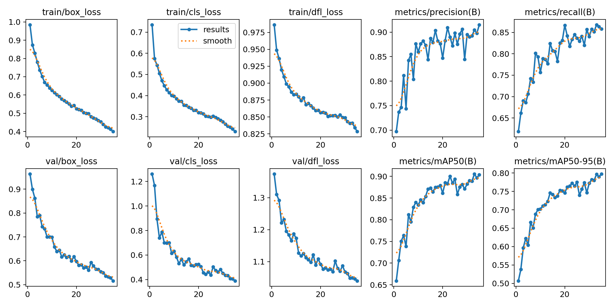
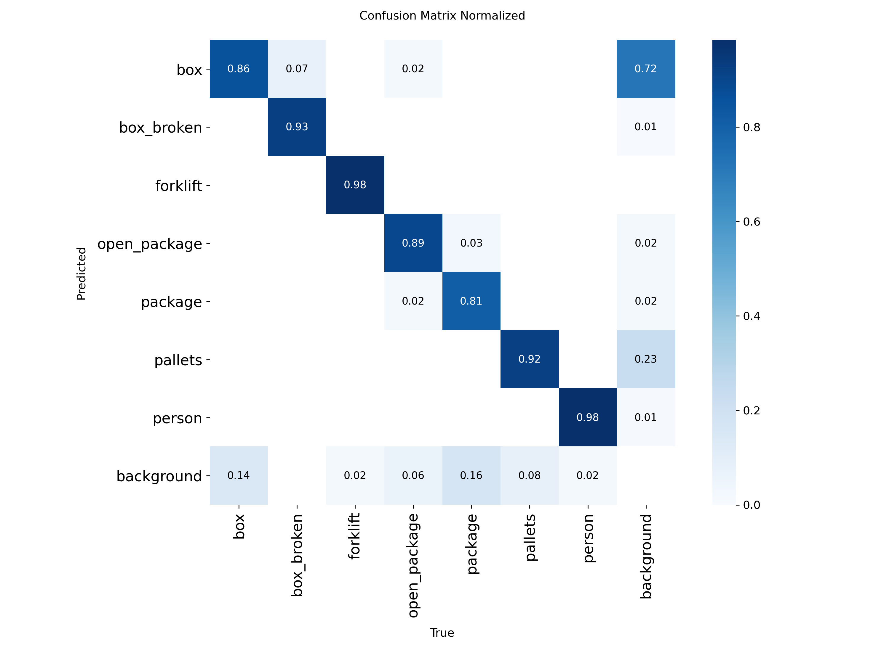

# CamEdge

Real-time detection, tracking and counting of items (bags and boxes) in video. I built it during my ML & Computer Vision internship at ElevateTrust.AI.

## Problem

In a loading area you want to know how many items were loaded and unloaded, straight from a camera feed. Counting by detection alone counts the same item many times, once per frame. CamEdge tracks each item and only counts it when it crosses a zone you define.

## How it works

1. **Detect:** each frame goes through a YOLO model (`best_bag_box.pt`) trained to find bags and boxes.
2. **Track:** ByteTrack gives every item a track ID, so the same item keeps the same ID across frames.
3. **Count:** you draw a "transfer zone" (region of interest). An item that enters the zone is counted as **Loaded**. An item that leaves after being inside is counted as **Unloaded**.
4. **App:** a Streamlit interface that works with uploaded videos (MP4, AVI, MOV, MKV) or a live webcam. It shows detections and live counts, lets you set the zone by hand or by percentages (with a frame capture for live streams), and can download the processed video. There is also a camera test and a debug mode.

## Results

The training run saved in [`metrci_results/`](metrci_results) used YOLOv8x at 640 px for 35 epochs, on a 7-class warehouse dataset (box, box_broken, forklift, open_package, package, pallets, person). Final-epoch validation metrics from `results.csv`:

| Precision | Recall | mAP@50 | mAP@50-95 |
|---|---|---|---|
| 0.915 | 0.858 | 0.904 | 0.797 |





## How to run

```bash
pip install -r requirements.txt
python -m streamlit run appv14.py
```

## Repo layout

| Path | What it is |
|---|---|
| `appv14.py` | Final Streamlit app |
| `best_bag_box.pt` | Trained detection weights |
| `Initial app versions/` | Earlier versions of the app |
| `notebooks/` | Training and counting experiments |
| `metrci_results/` | Training curves and metrics |
| `yaml/` | Training config (`args.yaml`, `data.yaml`) |
| `Camedge report.pdf` | Project report |
